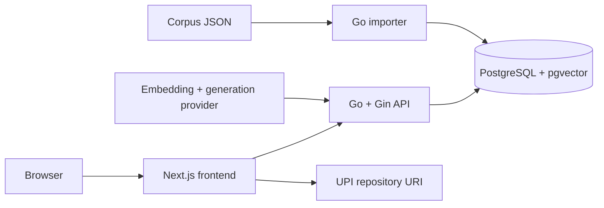

# SearchLens

SearchLens is a learning project for discovering Universitas Pendidikan Indonesia (UPI) thesis metadata and available abstracts. It supports lexical and hybrid retrieval, related records, corpus trends, and optional abstract-grounded synthesis. It never accesses restricted PDFs or chapter-level content.

Current release is local-only: PostgreSQL remains bound to loopback and the application runs on one host. Hosted deployment is [To Be Discussed](docs/TECH_DEBT.md); this repository does not currently claim public-production readiness.

New to RAG terminology? Start with the plain-language [RAG glossary](docs/GLOSSARY.md), which explains retrieval modes, embeddings, evaluation metrics, latency, chunking, grounding, and related terms using SearchLens examples.

## Architecture



The browser calls the API directly. The API validates search and filter inputs and queries PostgreSQL through `pgx`. A separate command in the same Go module imports the checked-in JSON files idempotently by repository URI.

## Requirements

- Docker with Compose
- [GVM](https://github.com/moovweb/gvm) with Go 1.27.1
- Node.js 20.9+ and npm

## Run locally

Select Go with GVM, then create the server environment:

```sh
gvm install go1.27.1 -B
gvm use go1.27.1
make env
```

Set `POSTGRES_PASSWORD` in the generated `.env`. Start PostgreSQL, apply the database migrations, and import the corpus:

```sh
make db-up
make migrate
make import
```

Start the API:

```sh
make api
```

In another terminal, install and start the frontend:

```sh
cd apps/frontend
cp .env.local.example .env.local
npm ci
npm run dev
```

Open <http://localhost:3000>. The API listens on <http://localhost:8080> by default. Stop PostgreSQL with `make db-down`.

## Database and corpus maintenance

### Apply database migrations

Run migrations after starting a new database and after pulling a change that adds a file under `apps/backend/migrations/`:

```sh
make db-up
make migrate
make migrate-report
```

`make migrate` applies the ordered SQL files to the database configured by root `.env`. `make migrate-report` prints the PostgreSQL and pgvector versions plus document and embedding counts. Migrations change the database schema; they do not import corpus records.

### Add corpus data

Place JSON files anywhere under `docs/repository-data/`. Each filename must match `repository_*_data.json` and end with a four-digit source year, for example `repository_physics_2026_data.json`. Importer reads `source_year` from that filename, not from `date_deposited`.

Each file must contain a JSON array whose records use this shape:

```json
{
  "title": "Required thesis title",
  "abstract": "Optional abstract",
  "authors": ["Author name"],
  "item_type": "Thesis (S1)",
  "subjects": "Optional subject",
  "divisions": "Program Studi Fisika",
  "depositing_user": "Optional depositor",
  "date_deposited": "26 Oct 2026 14:30",
  "uri": "https://repository.upi.edu/id/eprint/12345"
}
```

`title` and `uri` are required. Keep repository `uri` unchanged because it is the stable database key and authoritative source link. Use `divisions` for degree-program identity. Optional fields may be `null`; do not invent missing abstracts. Non-empty deposit dates must use `DD Mon YYYY HH:MM` with an English three-letter month.

Audit, import, and refresh embeddings after adding data:

```sh
node scripts/audit-corpus.mjs
make import
make embed
```

`make embed` requires `OPENROUTER_API_KEY` in root `.env`. Importer processes one file per transaction. Invalid data reports its filename and zero-based array position; that file is rolled back. Adding a degree program also requires expanding the fixed retrieval evaluation set before release.

### Correct or replace corpus data

Edit or replace the JSON file, keep each record's existing `uri`, then repeat the audit, import, and embedding commands above.

Do not delete database rows first. Import is idempotent: a new URI inserts one row, while an existing URI updates that row without creating a duplicate. Changes to title, abstract, authors, subjects, or divisions invalidate that record's embedding; `make embed` regenerates only missing or stale embeddings.

Import is not a full mirror operation. Removing a record from JSON or changing its URI does not remove the old database row, and there is no automatic prune command. [Back up the database](#database-backup), identify obsolete URIs, and delete only those rows explicitly. Never clear the whole table to correct one degree program.

## Checks

Audit the corpus and its fixed retrieval evaluation set:

```sh
node scripts/audit-corpus.mjs
node --test scripts/*.test.mjs
```

Run backend checks with the active GVM version:

```sh
make backend-test
```

Set `TEST_DATABASE_URL=${DATABASE_URL}` in `.env` to include PostgreSQL integration and retrieval evaluation tests.

Run frontend checks:

```sh
cd apps/frontend
npm test
npm run lint
npx tsc --noEmit
npm exec -- next build --webpack
```

With the API running against an imported corpus, measure search latency:

```sh
node scripts/benchmark-search.mjs
```

An alternate API base URL may be supplied as the first argument.

For the full local release smoke, keep the API running and write a new
evidence file (do not overwrite the committed result):

```sh
node scripts/release-smoke.mjs http://localhost:8080 /absolute/path/release-smoke.json
```

It checks readiness plus lexical, semantic, hybrid, related, trend, and
abstract-synthesis paths. The [verified release record](docs/chapter-3/PHASE-4.md)
is local-only; hosted
deployment remains [To Be Discussed](docs/TECH_DEBT.md).

## Database backup

Create a custom-format PostgreSQL backup:

```sh
docker compose --env-file .env exec -T db sh -c 'pg_dump --username "$POSTGRES_USER" --dbname "$POSTGRES_DB" --format=custom' > searchlens.dump
```

Restore replaces database objects and data. Stop the API first, then run:

```sh
docker compose --env-file .env exec -T db sh -c 'pg_restore --username "$POSTGRES_USER" --dbname "$POSTGRES_DB" --clean --if-exists --no-owner' < searchlens.dump
```

## Data and license

Original source code and project documentation are licensed under the [MIT License](LICENSE), copyright 2026 Khalifa Esha.

Files under `docs/repository-data/` are excluded from the MIT License. They contain publicly visible metadata and abstracts obtained from the [UPI Repository](https://repository.upi.edu/). Rights in those records remain with UPI and their respective authors; this project grants no rights to reuse them. Each record keeps its authoritative repository URI.

SearchLens is an independent learning project and is not affiliated with or endorsed by UPI. No restricted full text is included.
